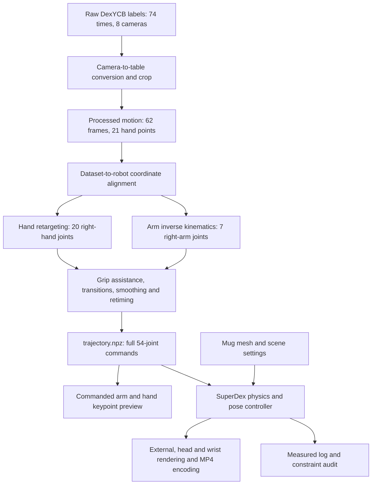

# How DexYCB 20200709_151032 becomes pickup_the_cup.mp4

This guide follows one recording through the current code. There are three different kinds of motion to distinguish:

1. **Recorded human motion:** measured 3D hand points and object poses in DexYCB labels.
2. **Commanded robot motion:** robot joint angles computed to approximate that human motion.
3. **Measured simulated motion:** how the robot and mug actually move under the controller, gravity and contact.

The video shows the third kind. A similar-looking hand posture does not by itself guarantee a stable grasp.

## The complete path



The default command runs conversion, retargeting and replay in that order, creates an arm-and-hand commanded-keypoint preview, and records three simulation camera views:

```bash
PYOPENGL_PLATFORM=egl LIBGL_ALWAYS_SOFTWARE=1 \
.venv/bin/python adaptive_control_project/scripts/run_task.py
```

All commands in this guide run from `/home/hoan/project_superdex`.

## 1. Read the original labels

Start at [`data/raw/20200709_151032/meta.yml`](../data/raw/20200709_151032/meta.yml).

It declares **74 time steps**, **eight camera serial numbers**, the right hand, and the calibration ID `20200702_151821`. Each camera folder contains 74 `labels_*.npz` files: **592 label files** altogether. The same instant is observed from multiple cameras; these are not 592 consecutive moments.

The labels already contain 3D information:

- `joint_3d`: 21 human hand points in camera coordinates.
- `pose_y`: object poses in camera coordinates.

`meta.yml` lists five objects in the original scene. Its `ycb_grasp_ind: 4` selects the fifth entry, object ID 14: the handled `025_mug`. Only that object's mesh is needed here.

The retained raw files are annotation data. This workflow does not estimate 3D hand poses from RGB images and does not require the source photographs.

## 2. Put observations in one table coordinate system

Different cameras describe the same point with different coordinates. The extrinsic calibration in [`data/raw/calibration/`](../data/raw/calibration/) supplies their spatial relationship and the AprilTag table frame.

`retarget_pipeline/data_convert.py` converts each camera's hand points and mug pose into that shared table frame, then averages the available observations. It fills missing hand samples by interpolation. Positions are in **metres**; time is in **seconds**; the table frame is **Z-up**.

The converter keeps the portion beginning when the hand is within 0.30 m of the mug in the horizontal plane. This sequence goes from 74 raw time steps to **62 processed frames at 30 FPS**. Its first and last timestamps are 0 and approximately **2.033 seconds**.

Run this stage alone:

```bash
.venv/bin/python adaptive_control_project/scripts/run_task.py --stage convert
```

The result is [`data/processed/dexycb_mug_20200709_151032.npz`](../data/processed/dexycb_mug_20200709_151032.npz):

| Array | Shape | Meaning |
| --- | --- | --- |
| `keypoints` | `(62, 21, 3)` | XYZ positions of the 21 human hand points |
| `wrist_pos` | `(62, 3)` | Position of point 0, the wrist |
| `wrist_rot` | `(62, 3, 3)` | Identity placeholders for this DexYCB converter; retargeting derives wrist orientation from hand-point geometry |
| `object_pose` | `(62, 4, 4)` | Recorded mug position and orientation in the table frame |
| `timestamps` | `(62,)` | Source sample times |
| `fps`, `hand`, `source` | Scalars/text | Sample rate, right-hand identity and provenance |

In the hand-point layout, point 0 is the wrist; points 1–4 describe the thumb, 5–8 the index finger, 9–12 the middle finger, 13–16 the ring finger, and 17–20 the little finger.

To inspect the file yourself:

```bash
.venv/bin/python - <<'PY'
import numpy as np
path = 'adaptive_control_project/tasks/pickup_the_cup/data/processed/dexycb_mug_20200709_151032.npz'
with np.load(path, allow_pickle=False) as motion:
    print(motion.files)
    print('hand points:', motion['keypoints'].shape)
    print('first wrist XYZ [m]:', motion['keypoints'][0, 0])
    print('time range [s]:', motion['timestamps'][[0, -1]])
PY
```

For a visual check, run `scripts/render_raw_preview.py`. It draws the human points and recorded object origin. This preview contains no robot retargeting or simulated grasp.

## 3. Align the demonstration with the robot

The dataset table and robot base have different origins and orientations. [`assets/annotation_alignment.json`](../assets/annotation_alignment.json) is a rigid 4×4 transform:

```text
robot_point = rotation × dataset_point + translation
```

Its upper-left 3×3 block rotates points, its first three entries in the last column translate them, and the final row is `[0, 0, 0, 1]`. It does not resize the hand.

The current transform uses a rotation about Z of approximately **130.54 degrees** and a translation of approximately **[0.7719, -0.4945, 0.2210] m**. Those explicit values were derived earlier from a related historical mug run. The active values are stored in the alignment JSON; they are not verified as the exact settings of an older reference MP4.

`pipeline.retarget_task()` loads this transform through `task.json`. The mug's initial scene placement describes the same robot workspace arrangement.

## 4. Convert a human hand into robot joints

The human input is 21 points. The Wuji right hand is controlled by **20 joint angles**. These are different representations, so copying coordinates into joint angles would not work.

`hand_retarget.py` and `cpp/hand.cpp` solve an optimization problem: find legal finger angles whose hand geometry approximates the observed human finger relationships. The default configuration is `configs/wuji_hand2_right_adaptive.yaml`. Its adaptive objective gives special treatment to fingertip and pinch relationships. Temporal regularization and filtering reduce jumps between frames.

The optimizer also derives a desired wrist position and orientation from the hand-point geometry.

The task declares an additional **0.15-radian finger-flexion assistance** (about 8.6 degrees), ramped in from source time `22/30` seconds over 0.3 seconds. This is an explicit grip adjustment inherited in magnitude from the related historical setup, not an angle measured from the human. It is clipped to hand joint bounds.

The saved trajectory keeps both `right_optimizer_hand_q` and the adjusted `right_hand_q`, plus `right_grasp_weight`, so you can see this distinction. The amount of assistance alone does not establish a stable physical grasp.

## 5. Move the robot arm to that wrist pose

The OpenArm right arm has **seven controlled joints**. `arm_ik.py` and `cpp/arm.cpp` perform inverse kinematics (IK): they seek arm angles that put the robot wrist near the desired position and orientation, while respecting joint bounds.

Forward kinematics asks, “Given joint angles, where is the wrist?” IK solves the reverse question. The hand optimizer handles finger shape; arm IK handles the wrist's placement in space.

The complete robot has 54 controlled joints: two arms with 7 joints each and two hands with 20 each. This recording controls the right arm and hand. The left side stays at its rest command. Keeping a 54-column command array matches the complete robot model.

## 6. Make a complete command timeline

The raw source is only about two seconds long. The simulation also needs a transition from the robot's rest posture and a final hold.

`task.json` declares a 2.5-second approach and 2-second hold before time scaling. The native trajectory preparation then projects commands into a position margin, smooths them, fits continuous interpolation, and slows the timeline to meet configured speed and acceleration caps. It samples commands at **200 Hz**, matching the 0.005-second physics step.

For the current settings, the complete prepared trajectory lasts approximately **43.3 seconds**. This is deliberate retiming, not a 43-second source recording. The source clock and replay clock are both stored in the archive.

Run through this stage without simulation:

```bash
.venv/bin/python adaptive_control_project/scripts/run_task.py --stage retarget
```

Read [`retarget/runs/pickup_the_cup/trajectory.npz`](../retarget/runs/pickup_the_cup/trajectory.npz):

- `source_timestamps` and `right_source_keypoints_world`: the original motion and its aligned geometry.
- `right_optimizer_hand_q`: the optimizer's finger angles before grip assistance.
- `right_hand_q`, `right_arm_q`: source-sampled retargeted joint angles.
- `timestamps` and `q_target`: the prepared full replay timeline.
- `dof_names`: which robot joint each command column controls.
- `scene_config`, `robot_from_source`, `preparation`: settings needed to explain and replay the commands.

Joint angles are in **radians**. The source-sampled arrays and prepared `q_target` have different sample counts because preparation changes timing and adds transitions.

## 7. Simulate what actually happens

`scene.py` loads the shared OpenArm/Wuji robot, constructs the table, and loads [`assets/mug.stl`](../assets/mug.stl) as a freely dynamic object. [`assets/scene.json`](../assets/scene.json) supplies its initial pose, configured mass of **0.118 kg**, gravity, controller gains and physics timing.

`asset.json` is a readable description of the mesh and configured mass. The simulation reads the operational parameters from `scene.json`.

The STL's rim opens along local **+Z**. The initial scene rotation puts this direction along world **+Z**, so the mug starts upright, while retaining the former handle azimuth (approximately 46.89°). The mesh's lowest local Z is −0.039003 m. Its initial origin Z is 0.260003 m, so the lowest vertex is at 0.221 m, exactly **1 mm above the tabletop**. The body remains free to move and tip under physics after initialization.

The upright correction changes only the simulated mug's initialization; it does not alter the recorded source data or requested robot joints. Run `--stage retarget` before `--stage replay` to apply it, or run the full default command. Saved `trajectory.npz` files embed their scene configuration, so a replay of an older archive can still start upside down.

The pose controller tries to follow `q_target`. The measured robot angles can differ because of tracking error and contact. The mug moves through **gravity and contact forces**; it is not attached to the hand. The recorded `object_pose` does not prescribe the simulated mug's motion.

A one-second stationary initialization occurs before the replay/video clock starts. The replay records desired and measured joints, velocities, controller efforts, mug position and orientation in `log.npz`.

## 8. Render the MP4 and read the result

`cameras.py` places an external camera, a stationary virtual head-position camera, and a camera mounted rigidly relative to the moving right wrist. The wrist mounting transform is in `assets/cameras.json`; these are visualization placements rather than measured sensor calibration. `render.py` draws the robot and mug meshes at their measured simulation poses. Frames are streamed to H.264 MP4 at **640×480, 30 FPS**.

```bash
PYOPENGL_PLATFORM=egl LIBGL_ALWAYS_SOFTWARE=1 \
.venv/bin/python adaptive_control_project/scripts/run_task.py --stage replay
```

All requested videos are directly in `videos/robot/`:

| Video | What it shows |
| --- | --- |
| [`pickup_the_cup.mp4`](../videos/robot/pickup_the_cup.mp4) | External view of measured robot and mug motion |
| [`pickup_the_cup_head.mp4`](../videos/robot/pickup_the_cup_head.mp4) | The same measured motion from a stationary virtual head position |
| [`pickup_the_cup_wrist_right.mp4`](../videos/robot/pickup_the_cup_wrist_right.mp4) | The same motion from a camera moving rigidly with the right wrist |
| [`pickup_the_cup_arm_hand_constraints.mp4`](../videos/robot/pickup_the_cup_arm_hand_constraints.mp4) | Both right-arm and finger keypoints computed by forward kinematics from commanded `q_target` |
| [`pickup_the_cup_tactile.mp4`](../videos/robot/pickup_the_cup_tactile.mp4) | 1280×720 dashboard: large wrist view with per-link force markers, external inset, palm/finger totals, contact status, and force history |

Each measured camera video has a matching `.camera.npz` sidecar with timestamps and camera poses. The keypoint preview has `.keypoints.npz` and `.json` sidecars with points, sampled commands, provenance and a command audit. It displays commanded geometry; it does not measure tracking or contact. [`videos/index.json`](../videos/index.json) identifies the actual camera and product even though the files share one directory.

Source previews are directly in `videos/raw/`; robot products are directly in `videos/robot/`. The camera names remain `external`, `head`, and `wrist_right` in metadata, with `_head` and `_wrist_right` suffixes distinguishing the additional camera files.

`task.json` selects these defaults using `default_cameras`, `default_constraint_preview_modes: ["arm_hand"]`, `video_layout: "flat"`, and `camera_calibration`. `--no-video` disables videos and the automatic preview. Conversion-only and retarget-only commands do not automatically render that preview. Add `--constraint-previews` explicitly to generate both hand-only and arm-and-hand previews.

To rebuild the readable tactile dashboard from the saved camera videos and force measurements:

```bash
.venv/bin/python adaptive_control_project/scripts/render_tactile_dashboard.py
```

This replaces only the tactile MP4 and updates its `.dashboard.json` provenance report. It preserves the five source/robot videos and the `.tactile.npz` force samples. The compositor validates matching capture clocks and saved measured joint/object motion; it rejects mismatches. It uses measured forward kinematics and mesh-bound centers to place force markers on the wrist view. No physics is stepped and no OpenGL scene is rendered.

The colors show sums of object-contact force magnitudes per hand link in newtons: blue at 0 N and red at 5 N or more. The dashboard has readable right-hand totals, palm/finger bars with a labeled range, contact/no-contact status, and a timeline. The numbers and force data remain unclipped. Markers indicate the link carrying an aggregated force; they are overlays without an occlusion test and do not locate actual contact points or show force-vector directions. This is a simulated tactile proxy, rather than pressure, taxels, or a hardware recording.

The `.dashboard.json` describes its wrist and external source views and measured-data provenance. The unchanged `.tactile.npz` contains capture times, ordered link names, and forces; its `world_from_camera` remains the original external capture pose, not calibration for the dashboard. Read the [detailed schema and inspection example](../data/README.md#simulated-contact-force-display).

For new physics and force samples, use the ordinary replay command with tactile enabled:

```bash
PYOPENGL_PLATFORM=egl LIBGL_ALWAYS_SOFTWARE=1 MPLCONFIGDIR=/tmp/pickup-tactile-mpl \
.venv/bin/python adaptive_control_project/scripts/run_task.py --stage replay --tactile
```

The default three cameras include `external` and `wrist_right`, so this also composes the dashboard after capture. An explicit `--cameras external wrist_right` selects the required pair. An external-only tactile replay produces the smaller single-camera force view and does not create the dashboard. Unlike the saved-data compositor, a physics replay refreshes measured logs, requested camera videos, and the automatic arm-and-hand preview.

Read `retarget/runs/pickup_the_cup/metrics.json` alongside the video:

- Command checks describe the requested motion.
- Measured checks describe actual simulated joint behavior and effort.
- Object-origin displacement describes movement, not proof of an upright sustained grasp.
- A rendered video can exist even when measured constraints fail.

The earlier upright-orientation check generated and fully decoded the four default robot videos, with **1,300 frames each at 640×480 and 30 FPS**. The improved-dashboard suite passes **194 regression tests**. Independent verification fully decoded the **1280×720** dashboard's 1,300 frames at 30 FPS and confirmed unchanged hashes for all five original videos and six NPZ sidecars, including the force data. The catalog contains six clips.

The published tactile replay has separate measurement provenance in [`retarget/runs/pickup_the_cup_tactile/`](../retarget/runs/pickup_the_cup_tactile/). Every measured-state array exactly matches the original upright replay. Its tactile sidecar has **1,300×74** force samples: 37 hand-link channels per side. Right-hand contact appears in 81 captured frames from **18.835 to 21.500 s**; the maximum right-hand magnitude sum is **24.685 N** at **19.235 s**, and the largest individual link value is **13.566 N**. The 5 N color endpoint does not clip these numbers.

The mug remains largely on the table: its origin rises at most about **3.45 mm**, with no sustained lift. Commanded motion and measured position/velocity checks pass, while measured acceleration and effort checks fail. The runner saves diagnostic videos/logs and exits with status 1. Read the [verification report](../retarget/runs/pickup_the_cup/system_check.json), original `metrics.json`, and [tactile replay metrics](../retarget/runs/pickup_the_cup_tactile/metrics.json). Results from the earlier upside-down initialization describe a different physical replay.

## Historical reference versus current reconstruction

The older historical reference clip is not present in this checkout. Its legacy controller and complete original settings are not recoverable from the surviving project files. Neither is required by the active reconstruction pipeline.

The active workflow uses the same identified sequence and mug geometry, an explicit alignment based on a related historical run, current native controllers and bounded command preparation. Changes in optimizer, interpolation, timing and contact dynamics can change the resulting video. The current source files and saved measurements make those steps inspectable.
